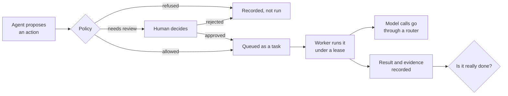

# Governed agent systems: field notes

Design notes on building AI agent systems that are allowed to act: what has to be true around the
model before its output is permitted to change anything.

> **An architectural case study.** These notes generalize lessons from agent systems I have built
> privately, and were drafted with AI assistance (Claude Code). They describe principles and
> tradeoffs. They do not describe, name or quantify any private system, and no private
> implementation is published here. The companion repositories are independent reference
> implementations written from scratch to illustrate each idea.

## The argument

An agent that only produces text can be wrong cheaply. An agent that sends the message, issues the
refund or merges the change cannot. Once output becomes action, most of the engineering moves out
of the prompt and into the system around it, and the questions become ordinary distributed-systems
and operations questions:

- Who decided this action was allowed, and can I show that later?
- If the worker dies halfway, does the action happen zero times, once, or twice?
- When the system reports "done", what is that claim based on?
- When I change which model handles a task, what else changes?

The notes below take these one at a time. Each is short, each names the failure it is about, and
each links to runnable code.

## The path of one action

The notes follow a single action from the moment an agent wants to take it to the moment the
system claims it is done. There are many valid ways to lay out the components; what the notes care
about is that each step below exists somewhere and leaves a record.

Each note covers one stretch of that path.

## The notes

| # | Note | The failure it addresses | Reference implementation |
| --- | --- | --- | --- |
| 1 | [Three answers, not two](notes/01-three-answers-not-two.md) | A check that never ran is reported as a passing one | [evidence-gate](https://github.com/Donovanfitch-dev/evidence-gate) |
| 2 | [Approval is a state, not a prompt](notes/02-approval-is-a-state.md) | An agent acts on something a human never actually agreed to | [agent-approval-console](https://github.com/Donovanfitch-dev/agent-approval-console) |
| 3 | [Leases, late workers and doing it once](notes/03-leases-and-late-workers.md) | A crashed or slow worker causes lost or duplicated work | [agent-task-runtime](https://github.com/Donovanfitch-dev/agent-task-runtime) |
| 4 | [Model choice is policy](notes/04-model-choice-is-policy.md) | A model swap silently changes cost, capability or behavior | [llm-routing-gateway](https://github.com/Donovanfitch-dev/llm-routing-gateway) |
| 5 | [Working in gated phases](notes/05-gated-phases.md) | A capability goes live before anyone has seen it be safe | — |
| 6 | [A failure-mode checklist](notes/06-failure-mode-checklist.md) | The same incident, rediscovered | — |

## How to read the status of these ideas

| Material | What it is |
| --- | --- |
| The six notes | Design principles and tradeoffs. Opinion, argued. |
| The four linked repositories | Working code with tests, built independently to demonstrate one idea each. Small on purpose. |
| Everything else | Not here. No production code, data, metrics or architecture of any private system is published. |

## License

Text and diagrams are licensed under [CC BY 4.0](LICENSE).
