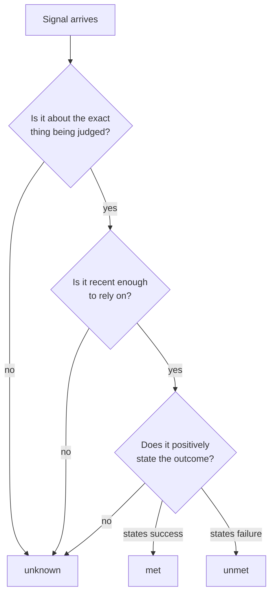

# 1. Three answers, not two

**Failure:** the system reports that something is done or safe, and the report is based on the
absence of an error.

## How it happens

Agent systems produce a lot of weak completion signals. A process exited with status zero. A
workflow run is green. The model said "I have completed the task." None of these says the intended
effect happened. A run can be green because the step that would have failed was skipped. A process
can exit cleanly after doing nothing.

The usual implementation makes it worse by collapsing three situations into two:

| What is actually true | What a boolean reports |
| --- | --- |
| The check ran and passed | pass |
| The check ran and failed | fail |
| The check did not run, or ran against something else, or ran last week | pass *or* fail, depending on a default nobody chose deliberately |

## The principle

Carry the third state all the way through. A status is `met`, `unmet` or `unknown`, and
`unknown` is never rounded in either direction. Then define success positively: a task is
successful only when a specific, validated artifact says so.

Three consequences follow.

1. **Evidence is bound to a subject.** A passing test run is evidence about one revision. A health
   probe is evidence about one deployment. Evidence about a neighbor is not evidence.
2. **Evidence expires.** What was true an hour ago may not be true now. The policy, not the
   collector, decides how old is too old.
3. **"Cannot tell" needs its own exit.** If the only outputs are go and no-go, people learn to
   read no-go as "probably a flake" and override it. A separate undetermined result keeps no-go
   meaningful.

## Tradeoffs

Three states cost more than two. Every consumer has to handle `unknown`, and early on a system
will report it often, because much of what looked like passing was really unobserved. That is the
point, but it has to be planned for: an undetermined result needs a clear next step (re-run this,
collect that), or it becomes one more thing to ignore.

There is also a judgment call in what conflicting evidence means. Treating disagreement as unknown
surfaces it; treating it as failure is safer and noisier. Either can be right. It should be a
visible policy choice per check.

## In code

[evidence-gate](https://github.com/Donovanfitch-dev/evidence-gate) implements this for release
readiness: three-valued requirements, revision binding, staleness, explicit waivers, and distinct
exit codes for go, no-go and undetermined.
