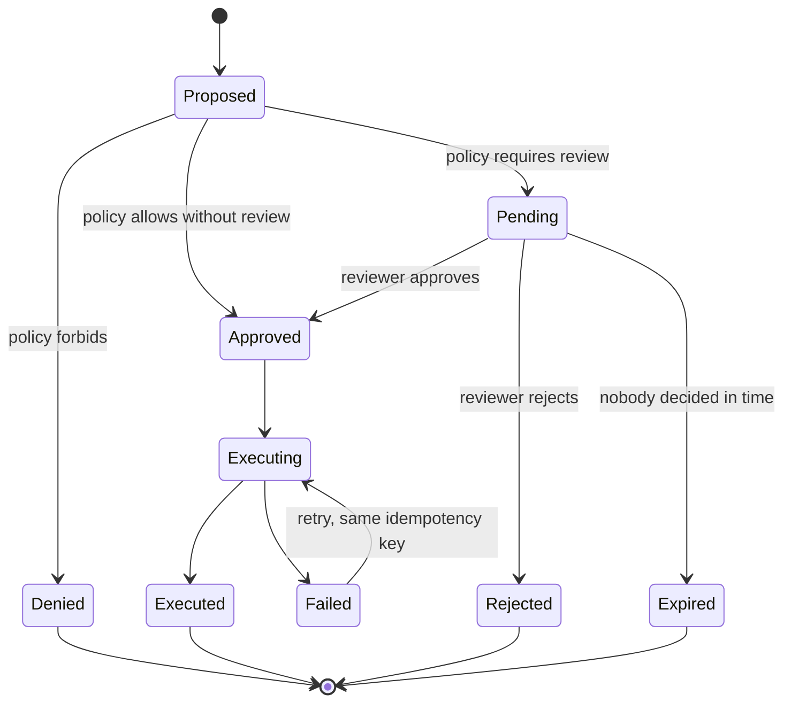

# 2. Approval is a state, not a prompt

**Failure:** an agent takes an action that a human "approved" in some loose sense, and afterwards
nobody can say exactly what was approved, by whom, or whether the thing executed was the thing
reviewed.

## How it happens

The quick way to add a human to the loop is to have the agent ask and wait: print the plan, block
until someone types yes. This puts the approval inside the agent's own control flow. The agent
decides when to ask, what to show and what counts as consent. If it summarizes the action
inaccurately, the human approves the summary. If the process restarts, the approval is gone or,
worse, assumed.

## The principle

Make the proposed action a durable record that lives outside the agent, with its own lifecycle.
The agent's job ends at *proposing*. A separate component evaluates policy, holds the proposal
until a decision exists, and executes only what was approved.

What this buys:

- **The reviewer sees the payload, not a description of it.** The exact recipient, amount or diff
  that will be executed is what is on the screen.
- **The execution is bound to the approval.** If the reviewer edits the payload, the edit is
  recorded and the edited version is what policy re-evaluates and what runs.
- **The approver is not the proposer.** Separation of duties is a check on the record, so it holds
  no matter which agent proposed.
- **Pending things expire.** An approval given to a stale proposal is an approval of something
  that may no longer be true.
- **Execution is idempotent.** A double click, a retry or a redelivered message performs the
  effect once, keyed on the proposal.

## Policy decides how much review

Not everything deserves a human. Reviewing every action trains people to click approve. A policy
layer sorts proposals by consequence: allow the small and reversible, require one reviewer for the
consequential, two for the costly, and refuse what should never happen. The thresholds are data,
so changing them is a reviewable change rather than a code change.

## Tradeoffs

The gate adds latency, and for some actions that latency is the whole cost. It also adds a queue
that someone has to work; an approval queue nobody watches is an outage with good intentions.
Expiry makes that visible instead of letting requests rot.

The audit trail is only as trustworthy as its storage. Chaining entries by hash makes tampering
detectable within the application, but a determined operator with database access needs an
external anchor or write-once storage to be kept honest.

## In code

[agent-approval-console](https://github.com/Donovanfitch-dev/agent-approval-console) is a small
full-stack demonstration: proposals, a risk policy, single and dual approval, edit-then-approve,
idempotent execution and a hash-chained audit log, with synthetic data throughout.
