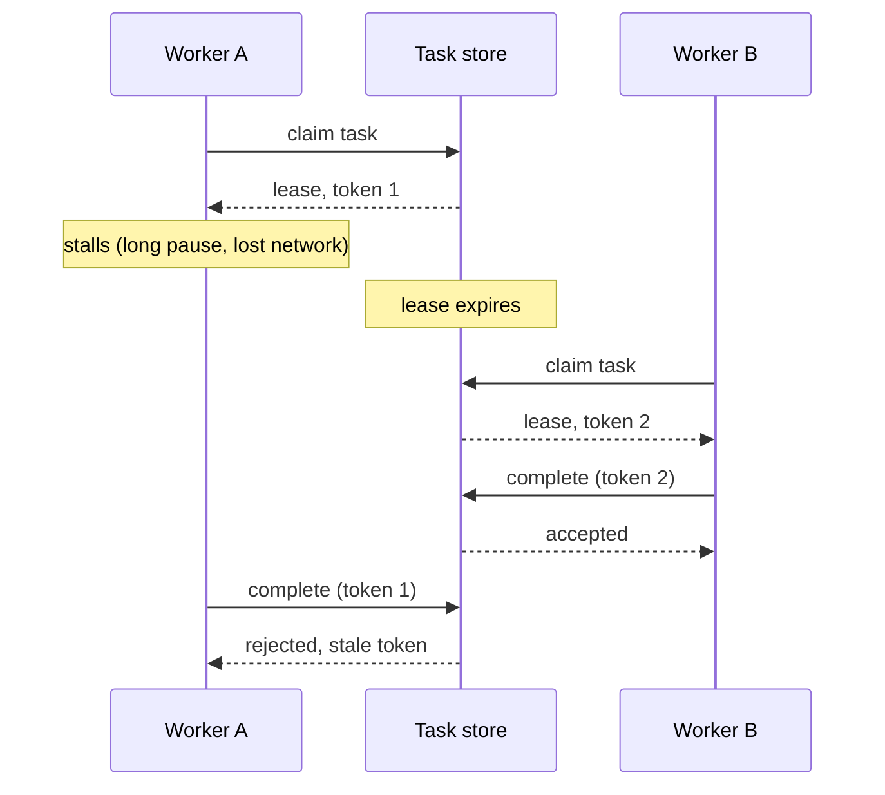

# 3. Leases, late workers and doing it once

**Failure:** an agent job runs for a long time, the worker running it dies or stalls, and the job
is either lost or done twice.

## How it happens

Agent work is slow and unpredictable in duration. A task that usually takes a minute sometimes
takes twenty. The naive queue marks a task "in progress" when a worker picks it up, and that mark
has no way to notice the worker is gone. Add a timeout to fix that, and a second problem appears:
the worker was only slow, the task was handed to someone else, and now two workers believe they
own it.

## The principle

Ownership of a task is a **lease**: it is held for a bounded time and has to be renewed. Each time
the task is claimed it gets a new, larger **fencing token**. Every write the worker makes carries
its token, and the store rejects any write whose token is not the current one.

The lease handles the dead worker. The token handles the worker that was not dead. Both are
needed; a timeout alone converts lost work into duplicated work.

## Reporting the result once

Finishing a task usually has to tell another system. Writing the result and then sending the
notification leaves a window where a crash loses the notification. Sending first and writing after
leaves a window where it is sent twice.

The transactional outbox closes the window: the terminal state and the outgoing message are
written in one transaction, and a separate dispatcher delivers the message until it is
acknowledged. Delivery is therefore at-least-once. Exactly-once *effect* comes from the receiver,
which deduplicates on a stable idempotency key.

It is worth being precise here because "exactly once" is so often claimed. No queue can promise
exactly-once delivery across a network. What can be built is at-least-once delivery plus an
idempotent receiver, and that is enough.

## Checkpoints

A retried attempt that starts from zero repeats work, and for agents that work costs money and may
have had side effects. Persisting a checkpoint after each meaningful step lets the next attempt
resume. The steps before the checkpoint must themselves be idempotent or already recorded, since
the crash can land between doing a step and recording it.

## Tradeoffs

Lease length is a real tension. Short leases recover quickly from a dead worker and punish slow
ones; long leases do the reverse. Heartbeats soften it, since a live worker can keep extending a
short lease, at the price of more writes.

Fencing only protects writes that go through the store checking the token. A side effect on an
outside system, performed by a worker that has not yet learned its lease is gone, is not fenced.
That is one more reason side effects belong behind an approval and an idempotency key (note 2).

## In code

[agent-task-runtime](https://github.com/Donovanfitch-dev/agent-task-runtime) implements leases,
fencing tokens, retry with backoff and dead-lettering, checkpoints and a transactional outbox on
SQLite, with a scripted demo of the takeover scenario above.
