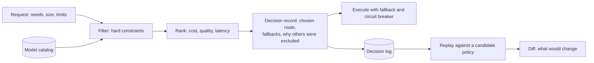

# 4. Model choice is policy

**Failure:** someone changes which model handles a task, and cost, latency, capability or behavior
shifts somewhere nobody was looking.

## How it happens

The model name starts life as a string constant next to the prompt. Then there are two models, one
for cheap tasks. Then a fallback for when the first provider is down. Then a rule that certain
data may only go to certain regions. Each addition is a conditional in application code, and after
a while the answer to "which model handles this request, and why" requires reading several files
and knowing which provider was having a bad day.

A swap that looks like a one-line change is then a change to cost, context limits, tool support
and output quality across every task that shared the constant.

## The principle

Treat routing as a policy evaluated per request, with the decision recorded.

- **The request states what it needs**, not which model it wants: capabilities, rough size, a cost
  ceiling, a latency class, where the data may go.
- **Hard constraints filter; preferences rank.** A model without tool support is excluded from a
  tool-using task. Among the eligible, weights decide. Keeping these separate keeps "cheaper" from
  ever overriding "able to do the job".
- **Every decision explains itself.** The record lists each candidate and the reason it was
  excluded or outranked. "Why did this go there" is answered from the record.
- **Failure handling is part of the route.** The fallback order is decided up front. A circuit
  breaker stops sending requests to a provider that is failing, and the decision notes that it was
  skipped.

## Replay before change

The decision log makes a routing change testable. Take recorded requests, run them through the
*proposed* policy without executing anything, and compare: which requests would go somewhere
else, which would have no eligible route at all, and what the estimated cost difference is. That
comparison can gate a merge the same way a test suite does.

Replay has a clear limit. It shows where traffic would go. It does not show whether the answers
would be as good. Quality needs evaluation on real outputs. Replay is the cheap check that runs
first and catches the structural mistakes: the task class that lost its only capable model, the
budget rule that now rejects a tenth of requests.

## Tradeoffs

Cost before execution is an estimate, because output length is unknown until the model produces
it. Budgets enforced on estimates need a margin, and reconciliation against actual usage
afterwards.

A router is one more component that can be wrong, and it sits in front of everything. Keeping it
deterministic (same inputs, same decision) is what makes it testable enough to earn that
position. Anything adaptive, such as routing on live latency, trades some of that away and should
be introduced deliberately.

## In code

[llm-routing-gateway](https://github.com/Donovanfitch-dev/llm-routing-gateway) implements the
pipeline above with mock providers and fictional prices: catalog, policy, explained decisions,
fallback with circuit breaking, budgets, and a replay command that diffs two policies over a
recorded log.
