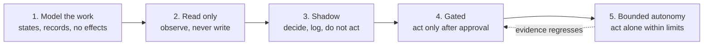

# 5. Working in gated phases

**Failure:** a capability that can act on the world is switched on before anyone has watched it
behave, because building it and enabling it were the same step.

## The principle

Separate *building* a capability from *granting* it, and put an observable stage between them.

1. **Model first.** Define the states, the records and the transitions with nothing connected.
   This stage is cheap to test exhaustively, and it is where most design errors are found.
2. **Read before write.** The first live integration only observes. It cannot break anything, and
   it shows whether the system's picture of the world matches the world.
3. **Shadow.** The system makes real decisions on real inputs and records what it *would* have
   done. Comparing those against what a person actually did is the most honest evaluation
   available before anything is at stake.
4. **Gate.** Actions are enabled, behind approval (note 2).
5. **Bounded autonomy.** For action types whose approval history is uneventful, policy can allow
   them without review, within stated limits. The arrow back matters as much as the arrow forward:
   autonomy is revoked when the evidence for it weakens.

One habit makes this hold up in practice: **enabling is its own change.** Releasing the code and
granting the capability are separate steps, and the second one is recorded with who did it and
when. A capability that turns itself on as a side effect of a deploy has skipped every stage
above.

## Decision records

A short decision record helps at each gate: the question, the options considered, the choice, and
what would cause it to be revisited. Writing it before the change is the useful part, because a
decision that cannot be explained in a few sentences is usually not made yet.

## Tradeoffs

Phasing is slower at the start, and for a throwaway prototype it is not worth it. It pays back
when the system can do something expensive or irreversible, which for agents is early.

Shadow mode has a ceiling: it cannot observe the consequences of actions it did not take. It tells
you the decision matched; it does not tell you the action would have worked.
